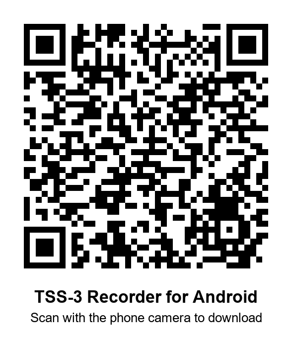
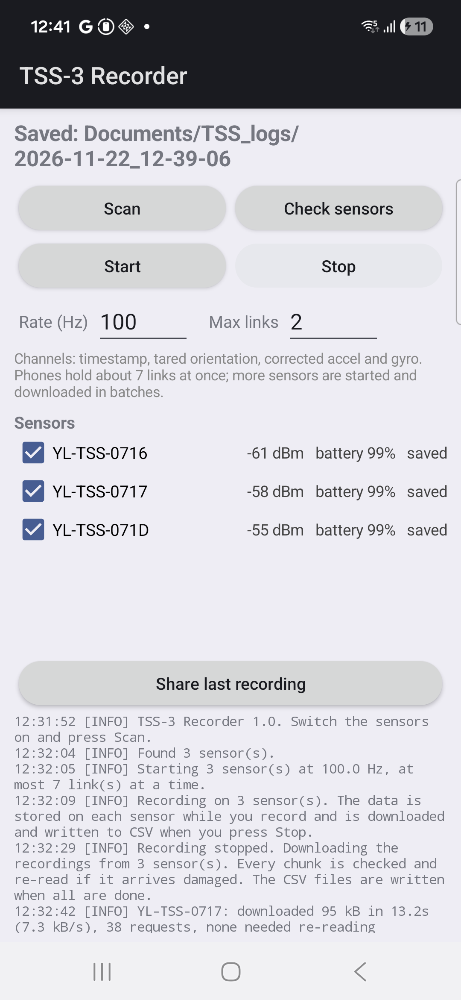
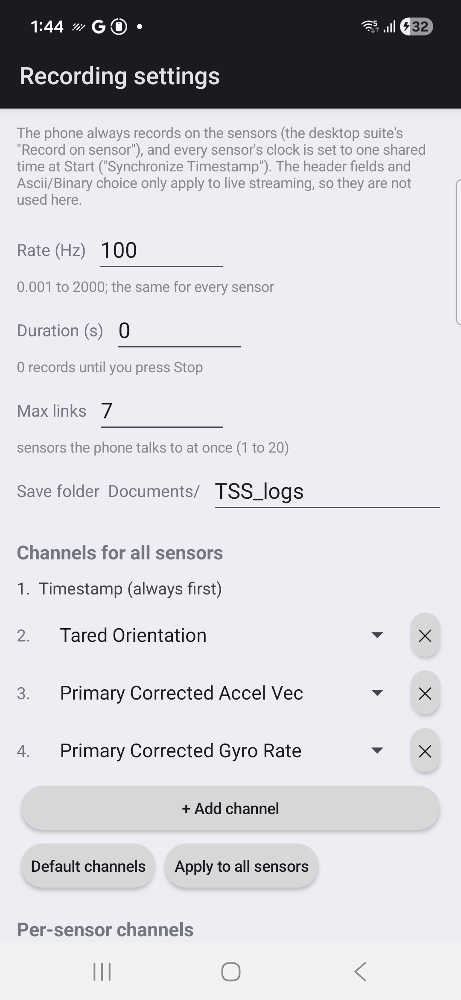
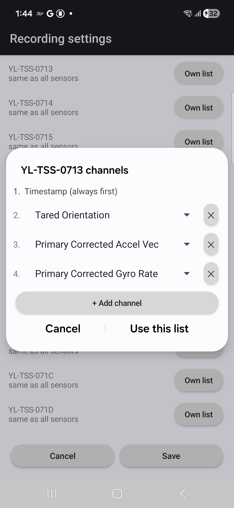

# TSS-3 Recorder for Android, and the TSS-3 Suite for Windows

Records Yost Labs TSS-3 (3-Space) sensors over Bluetooth, on an Android phone or a Windows PC.
Each sensor records to its own storage, so a weak or busy Bluetooth link cannot lose samples.
After **Stop**, every recording is downloaded and checked sample by sample, and the CSV files all
start and end together. Both programs write the same CSV files.

## Download

| | |
|---|---|
| **Android** phone | **[⬇ TSS-3_Recorder.apk](https://github.com/covdetbaba/tss3-recorder-android/releases/latest/download/TSS-3_Recorder.apk)** (2.2 MB, version 1.1). [Instructions below](#install). |
| **Windows** PC | **[⬇ TSS-3_Suite_Setup.exe](https://github.com/covdetbaba/tss3-recorder-android/releases/latest/download/TSS-3_Suite_Setup.exe)** (45 MB, build 2026.11.20). [Instructions below](#windows). |

The links always give the newest version. On the phone, open this page and tap the Android link,
or scan this with the phone camera:



All versions: [Releases](https://github.com/covdetbaba/tss3-recorder-android/releases).

## Requirements

- Android 10 or later, with Bluetooth LE. Tested on a Samsung Galaxy A26 5G (Android 16).
- TSS-3 sensors with onboard storage, advertising as `YL-TSS-...`.

## Install

1. Tap the download link above on the phone and open the downloaded file.
2. If Android asks, allow **Install unknown apps** for your browser or file manager. This
   happens once.
3. If Google Play Protect says the app is unknown, tap **More details** and then
   **Install anyway**. The app is not from the Play Store, so Play Protect has not seen it before.
4. Open **TSS-3 Recorder** and allow **Nearby devices** when it asks. That permission is what
   lets it find the sensors.

To update, download and install the new version over the old one. Your recordings and settings stay.

## Record

1. Switch the sensors on near the phone and tap **Scan**. It takes about 8 seconds.
   Untick any sensor you do not want. An orange signal value (-88 dBm or weaker) marks a weak link.
2. Optional: tap **Check sensors** to connect to each sensor once and show its battery. It also
   reads which sensor ids each sensor has (for example accel 7 and 9) and warns if a chosen channel
   is not supported by a sensor.
3. Check the line under the buttons. It shows the rate, duration, links, save folder and channels.
   Tap **Settings** to change them.
4. Tap **Start**. When the status line says **Recording**, all sensors are recording.
5. Tap **Stop**, or let the duration run out. The status line shows **Downloading NN%** until the
   files are saved. Keep the app open and the phone near the sensors until then. The screen stays on.
6. Tap **Share last recording** to send the files by email, Drive, and so on.



## Settings

**Settings** has the options of the desktop TSS-3 Suite's Log Config window. They are kept between uses.

| Setting | Meaning |
|---|---|
| Rate (Hz) | 0.001 to 2000, the same for every sensor (default 100). |
| Duration (s) | 0 records until you tap Stop. Any other value stops the recording by itself. |
| Max links | How many sensors the phone talks to at once (default 7). With more sensors than this, the app starts them in groups and lets them go while they record, then reconnects each one at Stop. Lower it if a phone refuses connections. |
| Save folder | The folder inside Documents (default `TSS_logs`). |
| Channels for all sensors | The timestamp always comes first, then up to 15 channels, chosen from the same list as the desktop suite. Channels that read one particular sensor, such as *Corrected Accel Vec* or *Raw Gyro Rate*, ask for its id. *Check sensors* fills in the ids your sensors report. **Default channels** restores tared orientation, primary corrected accel and primary corrected gyro. **Apply to all sensors** removes every per-sensor list. |
| Per-sensor channels | **Own list** gives one sensor its own channels. **Use general** puts it back on the list for all sensors. |

The phone always records on the sensors, like the desktop suite's *Record on sensor* option, and
always sets every sensor's clock to one shared time at Start, like *Synchronize Timestamp*. The
desktop suite's header fields and Ascii/Binary choice only apply to live streaming, so the phone
does not use them.

 

## Files

Recordings are saved in **My Files > Documents > TSS_logs** (or the folder chosen in Settings):

```
Documents/TSS_logs/<date_time>/<sensor>/<sensor>.csv
Documents/TSS_logs/<date_time>/log.txt
```

Each CSV starts with `Time (s), time64`: time in seconds and in microseconds on the shared clock.
One column per value of each chosen channel follows, named by the sensor. With the default
channels these are `qx, qy, qz, qw, cAx, cAy, cAz, cGx, cGy, cGz` (tared orientation, primary
corrected accelerometer, primary corrected gyroscope). These are the same files the fixed desktop
TSS-3 Suite writes. All files are cut to the stretch every sensor recorded, so they have the same
number of rows.

The app puts each sensor's own log settings back afterwards and saves nothing to the sensor's
flash. Each recording also stays on its sensor (`/DATA`), as it does with the desktop suite.

## Measured

| Test (Galaxy A26 5G) | Result |
|---|---|
| 13 sensors, 60 s at 100 Hz, 7 links at a time | 13 files of 6,200 rows each, starts and ends within 10 ms, no missing samples |
| 13 sensors, 50 Hz, 20 s duration, 4 channels for all and one sensor with its own list (orientation + corrected accel id 9) | stopped by itself at 20 s; 13 files of 1,091 rows each, within 17 ms, no missing samples |
| 3 sensors, 60 s, 2 links at a time (groups) | 3 files of 6,230 rows each, within 4 ms |
| Download speed | up to 11 kB/s per sensor; 13 sensors × 60 s saved 3 minutes after Stop |

## Troubleshooting

- **No sensors found.** Check that Bluetooth is on and that the app has the *Nearby devices*
  permission (Settings > Apps > TSS-3 Recorder > Permissions). Make sure the sensors are switched on.
- **"did not connect on the first try".** Android sometimes refuses a connection (status 133).
  The app retries up to 6 times on its own, and this message is only information.
- **A sensor is left out at Start.** It could not be reached, or it refused the chosen channels.
  Charge it, bring it closer, lower *Max links*, or run *Check sensors* to see which channels it
  cannot record. The other sensors still record.
- **Slow download.** The sensor with the weakest signal sets the pace. Once you tap Stop, the data
  is already on the sensors, so bringing them closer to the phone speeds up the download.

## Windows

`TSS-3_Suite_Setup.exe` installs a modified build of the Yost Labs 3-Space Suite (Python)
2026.10.27. Its main change is **Record on sensor**, which is on by default: every sensor records
to its own storage on one shared clock, and the files are downloaded and checked after Stop. On a
PC whose Bluetooth cannot carry all the sensors live, the original suite's files came back short
or with gaps. With this build every CSV covers the same time with no missing samples, measured with
13 sensors. Other changes: faster connecting (about 1.3 s per sensor instead of 35 to 75 s), no
freezing with many sensors, **Connect All**, automatic reconnection when a Bluetooth link drops,
and clearer messages. `WHAT_CHANGED.txt` in the program folder lists every change and the
measurements behind it.

**Needs:** Windows 10 (1709 or later) or Windows 11, 64-bit, with Bluetooth LE. No administrator
rights and no other software.

**Install**

1. Download `TSS-3_Suite_Setup.exe` and double-click it.
2. Windows may show *Windows protected your PC*, because the file is not signed by a publisher.
   Click **More info**, then **Run anyway**.
3. Answer **Yes**. Setup takes about 10 seconds and offers to start the suite.

Setup installs the program for the current Windows user (`%LOCALAPPDATA%\Programs\TSS-3 Suite`).
It writes the recording settings (Record on sensor, 100 Hz, timestamp, tared orientation,
corrected accel and gyro) after backing up any settings already there, and saves recordings in
`<your user folder>\TSS_logs`. It adds Start-menu and desktop shortcuts and an entry in
**Settings > Apps > Installed apps**, which is also where you uninstall it. It does not touch an
existing Yost Labs installation.

**Use:** switch the sensors on, press **Connect All**, and check that every sensor shows as
connected. Change channels, rate and duration in **Log Config**, then press **Start Logging** and
later **Stop Logging**. The time display shows *Downloading NN%* until the CSVs are written,
about 2 minutes per minute recorded with 7 sensors.

## Verify the files (optional)

| File | SHA-256 |
|---|---|
| `TSS-3_Recorder.apk` 1.1 | `d913f0d2ad95cee37c9fb087518d9100833b2c0d924944c36d99e2e9ec4209fd` |
| `TSS-3_Suite_Setup.exe` 2026.11.20 | `a02a7306e2f167e19ca83a757c516acbbe049471473126c15fa7b91b03ca2eec` |

---

These programs are independent and are not made by or affiliated with Yost Labs. TSS-3, 3-Space
and YL-TSS are names of Yost Labs products and are used here only to say which sensors the
programs work with. The Windows program is built from the Yost Labs 3-Space Suite, which is under
the MIT License (Copyright (c) 2025 Yost Labs Inc.). Its installer puts the license texts of the
suite and of every library it includes in the `LICENSES` folder of the program. Icons by
[Icons8](https://icons8.com). Both programs are provided as is, without warranty.
